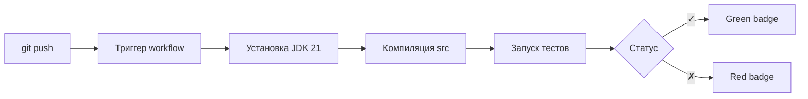

<h1 align="center">Iterative Parallelism</h1>

<p align="center">
  <b>Параллельные скалярные операции над списками с поддержкой шага выборки</b>
</p>

<p align="center">
  <a href="https://github.com/meloy156/IterativeParallelism/actions/workflows/build.yml">
    
  </a>
  
  
  
  
  
  
</p>

---

## 📌 О проекте

**IterativeParallelism** — это реализация двух интерфейсов:

- `ScalarIP` — параллельные скалярные операции над списками.
- `NewScalarIP` — то же самое, но с дополнительным параметром `step` (шаг выборки).

Каждый метод **разбивает список на `threads` частей**, обрабатывает их **параллельно** в отдельных потоках и **объединяет** локальные результаты в один глобальный ответ.

Проект демонстрирует классический паттерн параллельных вычислений:

```
Partition  →  Process  →  Reduce
```

---

## 🧠 Что демонстрирует проект

| Тема | Где применяется |
|:-----|:----------------|
| Многопоточность | `Thread`, `start()`, `join()` |
| Синхронизация | `synchronized`, `AtomicInteger`, `AtomicLong` |
| Обработка прерываний | `InterruptedException`, `interrupt()` |
| Разделяй и властвуй | Разбиение задачи на подзадачи |
| Race condition | Защита общих данных |
| Happens-before | Видимость изменений после `join()` |

---

## ✨ Возможности

| Метод | Что делает | Возвращает |
|:------|:-----------|:-----------|
| `argMax` | Индекс **первого максимума** | `int` |
| `argMin` | Индекс **первого минимума** | `int` |
| `indexOf` | Индекс **первого** подходящего элемента | `int` или `-1` |
| `lastIndexOf` | Индекс **последнего** подходящего элемента | `int` или `-1` |
| `sumIndices` | **Сумма индексов** подходящих элементов | `long` или `0` |

Каждый метод существует в **двух версиях**:

1. Без шага (обрабатываются **все** элементы).
2. С параметром `step` (обрабатываются только индексы, **кратные** `step`).

---

## ⚙️ Как это работает

### Схема разбиения

```
Исходный список: [3, 1, 4, 1, 5, 9, 2, 6]
threads = 4, step = 1

┌─────────────┬─────────────┬─────────────┬─────────────┐
│  Поток 0    │  Поток 1    │  Поток 2    │  Поток 3    │
│  [0..2)     │  [2..4)     │  [4..6)     │  [6..8)     │
│  max = 3    │  max = 4    │  max = 9    │  max = 6    │
│  idx = 0    │  idx = 2    │  idx = 5    │  idx = 7    │
└─────────────┴─────────────┴─────────────┴─────────────┘
                        │
                        ▼
              Глобальный максимум: 9 (индекс 5)
```

### Этапы выполнения


1. **Проверки.** Пустой список — обрабатывается по контракту. `threads` валидируется.
2. **Разбиение.** `threads = min(threads, size)`, `chunkSize = ceil(size / threads)`.
3. **Запуск потоков.** Каждый обрабатывает свой диапазон `[from, to)`.
4. **Ожидание.** Главный поток вызывает `join()` для каждого рабочего.
5. **Слияние.** Локальные результаты объединяются в один глобальный.

---

## 📐 Параметр `step`

Обрабатываются только индексы, **кратные `step`** (счёт с нуля):

| `step` | Какие индексы берём | Смысл |
|:------:|:--------------------|:------|
| `1` | `0, 1, 2, 3, ...` | Все элементы |
| `2` | `0, 2, 4, 6, ...` | Чётные индексы |
| `3` | `0, 3, 6, 9, ...` | Каждый третий |
| `5` | `0, 5, 10, 15, ...` | Каждый пятый |

### Пример

```text
values = [3, 100, 1, 50, 2, 200, 4]
step = 2

Индексы:    0    1    2    3    4    5    6
Значения:   3  100    1   50    2  200    4
            ✓    ✗    ✓    ✗    ✓    ✗    ✓
            │         │         │         │
            └─────────┴─────────┴─────────┘
            Рассматриваются: 3, 1, 2, 4

Максимум = 4 (индекс 6)
```

> Элемент `200` на индексе `5` **игнорируется**, потому что `5` не кратно `2`.

---

## 📚 API

### Интерфейс `ScalarIP`

```java
public interface ScalarIP {
    <T> int  argMax      (int threads, List<T> values, Comparator<? super T> comparator);
    <T> int  argMin      (int threads, List<T> values, Comparator<? super T> comparator);
    <T> int  indexOf     (int threads, List<T> values, Predicate<? super T> predicate);
    <T> int  lastIndexOf (int threads, List<T> values, Predicate<? super T> predicate);
    <T> long sumIndices  (int threads, List<? extends T> values, Predicate<? super T> predicate);
}
```

### Интерфейс `NewScalarIP`

```java
public interface NewScalarIP extends ScalarIP {
    <T> int  argMax      (int threads, List<T> values, Comparator<? super T> comparator, int step);
    <T> int  argMin      (int threads, List<T> values, Comparator<? super T> comparator, int step);
    <T> int  indexOf     (int threads, List<T> values, Predicate<? super T> predicate, int step);
    <T> int  lastIndexOf (int threads, List<T> values, Predicate<? super T> predicate, int step);
    <T> long sumIndices  (int threads, List<? extends T> values, Predicate<? super T> predicate, int step);
}
```

---

## 🚀 Быстрый старт

### Требования

| Компонент | Версия |
|:----------|:-------|
| Java | **21+** |
| Git | 2.30+ |

### Сборка вручную

```bash
git clone https://github.com/meloy156/IterativeParallelism.git
cd IterativeParallelism

mkdir -p out
find src -name "*.java" -print0 | xargs -0 javac -cp "lib/*" -d out
```

### Запуск тестов

```bash
java -cp "out:lib/*" \
     info.kgeorgiy.java.advanced.iterative.Tester scalar IterativeParallelism
```

> На Windows разделитель classpath — `;`, на Linux/macOS — `:`.

---

## 💻 Использование

### Базовые примеры

```java
IterativeParallelism ip = new IterativeParallelism();
List<Integer> values = List.of(3, 1, 4, 1, 5, 9, 2, 6);

int  maxIdx    = ip.argMax(4, values, Integer::compare);         // 5
int  minIdx    = ip.argMin(4, values, Integer::compare);         // 1
int  idxOf5    = ip.indexOf(4, values, x -> x == 5);             // 4
int  lastSmall = ip.lastIndexOf(4, values, x -> x < 3);          // 6
long sumEven   = ip.sumIndices(4, values, x -> x % 2 == 0);      // 0 + 2 + 7 = 9
```

### С шагом

```java
int maxEven = ip.argMax(4, values, Integer::compare, 2);         // 6 (значение 2)
int minOdd  = ip.argMin(4, values, Integer::compare, 3);         // 1 (значение 1)
```

### Со своим компаратором

```java
List<String> words = List.of("a", "bbbb", "cc", "ddd");
int longest = ip.argMax(2, words, Comparator.comparingInt(String::length));  // 1
```

---

## 📁 Структура проекта

```text
IterativeParallelism/
├── .github/
│   └── workflows/
│       └── build.yml                 # Конфигурация CI (GitHub Actions)
├── lib/                              # Внешние зависимости (тестеры)
│   ├── base.jar
│   └── info.kgeorgiy.java.advanced.iterative.jar
├── src/
│   └── IterativeParallelism.java     # Реализация
├── .gitignore
├── LICENSE                           # MIT
└── README.md
```

---

## 🔄 CI / CD

Проект использует **GitHub Actions** для автоматической проверки кода.

### Что делает CI



- **Триггеры:** `push` и `pull_request` в ветку `main`.
- **Окружение:** Ubuntu Latest.
- **JDK:** Temurin 21.
- **Шаги:** компиляция всех `.java` → запуск `Tester` из `lib/`.

### Файл конфигурации

```yaml
name: Java CI

on:
  push:
    branches: [ "main" ]
  pull_request:
    branches: [ "main" ]

jobs:
  build:
    runs-on: ubuntu-latest

    steps:
      - uses: actions/checkout@v4
      - uses: actions/setup-java@v4
        with:
          java-version: '21'
          distribution: 'temurin'

      - name: Compile
        run: |
          mkdir -p out
          find src -name "*.java" -print0 | xargs -0 javac -cp "lib/*" -d out

      - name: Run tests
        run: |
          java -cp "out:lib/*" info.kgeorgiy.java.advanced.iterative.Tester scalar IterativeParallelism
```

### Локальный запуск того же

```bash
mkdir -p out
find src -name "*.java" -print0 | xargs -0 javac -cp "lib/*" -d out
java -cp "out:lib/*" info.kgeorgiy.java.advanced.iterative.Tester scalar IterativeParallelism
```

---

## 🧪 Тестирование

### Что проверяется

- ✅ Корректность всех методов **без `step`** и **со `step`**.
- ✅ Работа с разным количеством потоков (`threads = 1..10`).
- ✅ Пустые списки, один элемент, дубликаты.
- ✅ Синхронизация под нагрузкой.
- ✅ Производительность (ускорение при увеличении `threads`).

### Пример успешного прогона

```text
=== test01_argMax()             done in  20ms
=== test02_argMin()             done in   6ms
=== test03_indexOf()            done in   5ms
=== test04_lastIndexOf()        done in   7ms
=== test05_sumIndices()         done in  14ms
=== test10_sleepPerformance()   done in   8ms
=== test11_burnPerformance()    done in   4ms
=== test91_stepArgMax()         done in  20ms
=== test92_stepArgMin()         done in   6ms
=== test93_indexOf()            done in   5ms
=== test94_lastIndexOf()        done in   7ms
=== test95_sumIndices()         done in   7ms
=== test96_stepPerformance()    done in 3129ms

All tests passed ✓
```

---

## 🛡️ Обработка исключений

| Исключение | Когда | Что делает программа |
|:-----------|:------|:---------------------|
| `InterruptedException` | Главный поток прерван во время `join()` | Пробрасывается наверх; рабочие потоки прерываются |
| `NoSuchElementException` | `argMax` / `argMin` на пустом списке | Бросается по контракту |
| `IllegalArgumentException` | `threads < 1` | Бросается по контракту |

### Прерывание

Если главный поток прерывают, все рабочие получают `interrupt()` — чтобы не продолжать считать впустую. Это позволяет корректно завершать программу без «висящих» потоков.

---

## 🔬 Особенности реализации

### Синхронизация

| Метод | Механизм | Почему |
|:------|:---------|:-------|
| `argMax` / `argMin` / `indexOf` | Массив `int[]`, каждая ячейка — своя | Нет гонки, максимальная скорость |
| `lastIndexOf` | `AtomicInteger` + `synchronized` | Check-then-act нужно защитить |
| `sumIndices` | `AtomicLong` | Атомарное сложение без блокировок |

### Разбиение работы

```java
threads   = Math.min(threads, sizeList);           // не больше элементов
chunkSize = (sizeList + threads - 1) / threads;    // округление вверх
```

Гарантирует:

- ✅ Все куски непустые (нет `break` и `null` в массиве потоков).
- ✅ Хвост списка не теряется (благодаря округлению вверх).
- ✅ Работает при `threads > size` (избыток отбрасывается).

### Слияние результатов

```java
int best = -1;
T   bestVal = null;
for (int i : result) {
    if (i == -1) continue;                        // пропускаем пустые ячейки
    if (bestVal == null ||
        comparator.compare(values.get(i), bestVal) > 0) {
        best    = i;
        bestVal = values.get(i);
    }
}
```

---

## 🗺️ Roadmap

- [x] Реализация `ScalarIP`
- [x] Реализация `NewScalarIP` (с `step`)
- [x] Покрытие всеми тестами `info.kgeorgiy.java.advanced.iterative`
- [x] Настройка CI (GitHub Actions)
- [x] README с бейджами и документацией
- [ ] Добавить JUnit-тесты
- [ ] Покрытие JMH-бенчмарками
- [ ] Перевод сборки на Maven / Gradle

---

## 🤝 Вклад

Проект открыт для предложений. Если нашёл баг или хочешь что-то добавить:

1. Форкни репозиторий.
2. Создай ветку: `git checkout -b feature/amazing-feature`.
3. Закоммить: `git commit -m "Add amazing feature"`.
4. Запушь: `git push origin feature/amazing-feature`.
5. Открой Pull Request.

---

## 📄 Лицензия

Проект распространяется под лицензией **MIT**. См. файл [LICENSE](LICENSE).

Это значит, что вы можете свободно:

- ✅ Использовать код в личных и коммерческих проектах.
- ✅ Изменять, распространять, продавать.
- ✅ Использовать без указания авторства в продукте.

При условии сохранения текста лицензии и указания авторства в исходниках.

---

## 👤 Автор

<table>
  <tr>
    <td align="center">
      <a href="https://github.com/meloy156">
        <br>
        <sub><b>meloy156</b></sub>
      </a>
    </td>
  </tr>
</table>

---

<p align="center">
  <i>Сделано с ☕ и небольшим количеством <code>synchronized</code></i>
</p>

<p align="center">
  <a href="https://github.com/meloy156/IterativeParallelism/stargazers">
    
  </a>
  <a href="https://github.com/meloy156/IterativeParallelism/network/members">
    
  </a>
</p>